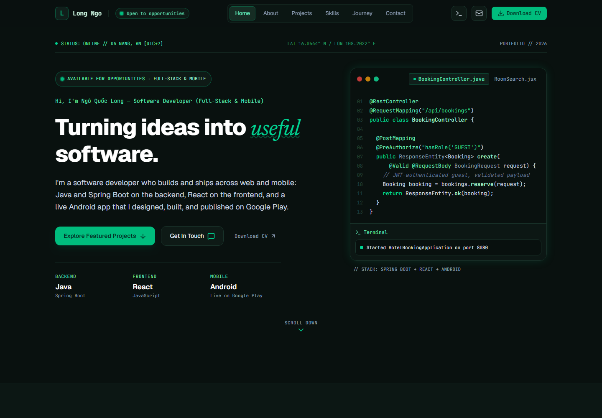

# Ngô Quốc Long — Portfolio

Personal portfolio of Ngô Quốc Long, a software developer working across full-stack web and Android.

**Live site:** https://longngoportfolio.vercel.app/



## What's on it

- **Projects** — Daily Reset (a published Android app), a social media content automation tool, a hotel booking system, and an e-commerce platform
- **Skills** — backend, frontend, mobile, databases, cloud, and security tooling
- **Journey** — work experience, education, and certifications
- **Contact** — a form that delivers messages by email

## Tech stack

- [Next.js](https://nextjs.org) (App Router) and React, written in TypeScript
- [Tailwind CSS](https://tailwindcss.com) for styling
- [Web3Forms](https://web3forms.com) for the contact form
- Deployed on [Vercel](https://vercel.com)

## Running locally

Requires Node.js 20 or later.

```bash
npm install
npm run dev
```

Then open http://localhost:3000.

To have the contact form send messages, create a `.env.local` file with a Web3Forms access key:

```
NEXT_PUBLIC_WEB3FORMS_KEY=your-access-key
```

Without the key, the form opens the visitor's email app instead.

## Editing content

All text on the site (profile, projects, skills, experience) lives in [`src/data/site.ts`](src/data/site.ts). The page sections are components in [`src/components`](src/components).
